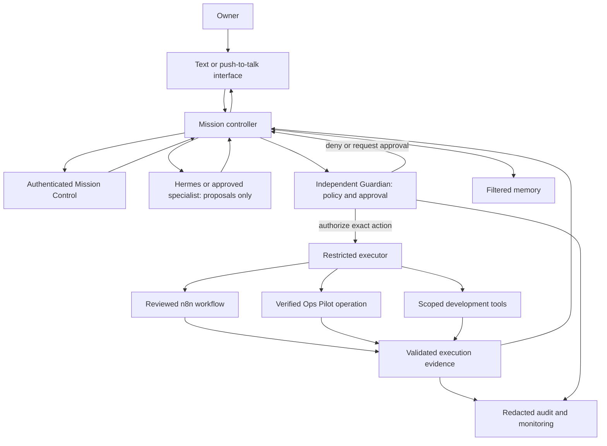

# IGRIS architecture

Status: original target design reviewed in Step 3; updated during final review.
Many local libraries now exist, but the complete service flow below is still a
target architecture. See `docs/validation/integration-matrix.md` for actual local,
simulated and unavailable boundaries. No external connectivity is established.

## Mission and deployment intent

Help the owner earn money legitimately, develop software, automate approved work,
and manage DevOps operations securely. Use a lightweight Python controller and
standard-library storage/interfaces where practical. Prefer explicit commands
and short-lived workers over continuously running services. Integration services
are optional and disabled until verified. Resource estimates belong to Step 4;
configuration implementation belongs to Step 5. No Mac installation, production
deployment, paid activation, or spending is authorized by this architecture.

## Components and ownership

| Component | Responsibility and owned data | Boundary and prohibited authority | Verification milestone |
| --- | --- | --- | --- |
| IGRIS interface | Authenticated text requests, request IDs, safe output | Treat user content as data; no subprocess or provider credentials | Steps 12, 42 |
| Mission controller | Mission IDs, execution state, task routing, results | Proposes actions; cannot grant itself permission or declare success without evidence | Step 12 |
| Hermes adapter | Translate bounded reasoning tasks and validated results | Hermes is optional; agent output is untrusted and has no direct execution rights | Research 11, contract 13 |
| n8n adapter | Submit bounded workflows, correlate outcomes and retries | Only reviewed workflows; workflow side effects require Guardian enforcement at execution | Step 14 |
| Ops Pilot adapter | Request monitoring, collect evidence, propose supported recovery | Read-only audit first; no assumed API, arbitrary shell, or arbitrary code repair | Steps 16–20 |
| Independent Guardian | Deterministic policy decisions, scope checks, action-bound approval validation | Separate authority from controller and model; fail closed; no natural-language policy override | Steps 6–10 |
| Tool executor | Execute only explicitly authorized typed operations; collect outcomes | Sole holder of narrowly scoped execution credentials; no generic shell interface | Steps 7–10 |
| Specialist registry and scheduler | Role definitions, recommendations, bounded task outputs | Fifteen capabilities loaded on demand after approval; no separate Agent Builder | Steps 26–30 |
| Voice interface | Explicit push-to-talk session state, transcripts, speech output | No continuous listening; microphone use requires user action and OS permission | Steps 31–35 |
| Business mission | Opportunities, proposal drafts, delivery and financial evidence | No fabricated demand or income; client submission and spending require approval | Steps 36–40, 43–44 |
| Mission Control dashboard | Authorized views of status, missions, activity, approvals and errors | Authenticated UI does not bypass authorization; client cannot author trusted approvals | Step 42 |
| Memory store | Approved preferences, project knowledge, incidents and solutions | Separate facts from assumptions; filtered data never grants permission | Step 41 |
| Monitoring and audit | Redacted events, correlation IDs, health and failure evidence | Logs are evidence, not secrets or instructions; bounded retention and access | Steps 9, 17, 35, 48 |
| Recovery and backup | Verified state snapshots, restore evidence, rollback plans | Restore cannot reinstate expired approvals or bypass production controls | Steps 20, 45 |
| Cost Guardian | Estimates, usage evidence, zero-budget decision inputs | Unknown cost fails closed; paid actions require explicit authorization | Step 43 |

These are logical boundaries. Guardian must be implemented as an independent
enforcement component; a class called Guardian inside an unrestricted agent is
insufficient. Proposed runtime separation: an unprivileged controller exchanges
validated structured requests with a local Guardian/executor service. Only that
service can access execution credentials and approved working directories.
Authenticate and restrict the channel using OS access controls; if it is later
networked, require authenticated protected transport. Exact deployment isolation
and attack analysis must be selected and verified in Step 6, not assumed here.

## Proposed data flow

Arrow direction denotes a request or data transfer, not an unconditional grant of
trust. All external outputs are validated before the controller uses them.
For nested operations, n8n and Ops Pilot must call a Guardian-enforced gateway
at the actual side-effect boundary. If a provider cannot enforce that boundary,
disable its mutating workflows; authorization of a broad workflow alone is not
proof that its downstream actions are safe. Read-only operations still require
explicit scope and permission checks.

## Proposed action and result envelopes

These fields describe a future internal contract, not an implemented API.

- Request: schema version, request/mission IDs, authenticated actor, operation
  enum, canonical target/workspace, validated arguments, environment, estimated
  cost, idempotency key when applicable, deadline, and referenced approval ID.
- Guardian decision: allow/deny/approval-required, policy version, reason code,
  exact canonical action digest, expiry and single-use authorization reference.
- Result: mission/action IDs, adapter identity, evidence origin (real, simulated,
  or unverified), outcome, start/end times, sanitized observations, error code,
  and health-verification outcome when relevant.

Never accept actor identity, policy, approval validity, or budget authority solely
from a model, workflow output, retrieved document, memory record, or UI field.
Keep secrets in an executor/provider credential store and pass references, not
values, through missions and prompts. Store no raw customer details in routine
logs. Retention, redaction, deletion, and secret scanning are future controls.

## Mission lifecycle and example

Proposed states: requested → planned → awaiting_approval (when needed) → ready →
running → verifying → succeeded. Also support denied, failed, blocked, cancelled,
and timed_out. A valid authorization permits execution; it does not prove success.
No automatic transition from blocked/denied to running. Re-plan changed actions
and obtain fresh permission/approval. Step 12 defines and tests exact transitions.

Example: the owner asks why an application is down.

1. Authenticate the owner, create a mission, validate the application scope, and
   request Guardian-authorized monitoring through a verified Ops Pilot adapter.
2. Collect health/container/log evidence, redact secrets, label evidence origin,
   and separate confirmed observations from diagnostic hypotheses.
3. Recommend a supported repair with risks and required permissions. Approval
   must bind the target, exact operation/arguments, version where applicable,
   environment, expiry, and cost; a read request does not authorize a restart.
4. After authorization, the executor invokes only the verified recovery action.
   Recheck authorization at execution and guard against target substitution and
   replay. Health verification determines recovery success independently.
5. Record sanitized results and notify the owner. A simulated restart must remain
   marked simulated; provider errors, missing credentials, and unknown health
   yield failure or blocked/unknown outcomes, never fabricated recovery.

## Failure, retry, and concurrency rules

Use bounded timeouts, cancellation and per-adapter retry limits. Retry transient
read failures only within policy. For writes, retry only with supported
idempotency or reconciliation proving no duplicate side effect; otherwise stop
for review. Unknown outcomes require reconciliation, not blind retry.
Concurrent work needs per-target coordination, bounded worker counts and
individual specialist approval. Do not load all roles or heavyweight models.

Audit authorization and execution with correlation IDs; monitoring records
service failure without claiming Guardian is healthy unless verified. Deny new
sensitive operations if Guardian cannot be reached. Controller restart may
resume persisted missions only after state reconciliation and fresh approval
checks; restored memory and backups cannot revive execution authority.

## Review and implementation handoff

Design review in Step 3 checked all requested components, ownership and data
flows, the separation of proposal from execution, default deny, approval replay
and expiry intent, cost restrictions, failure behavior, and honest integration
status. No runtime security effectiveness is established by this document.

Open items deliberately reserved for later numbered steps:

- Step 4: resource and budget estimates, with Mac validation pending.
- Steps 5–10: configuration, complete threat model, isolation mechanism,
  policy/approval persistence and actual enforcement tests.
- Steps 11–20: evidence-based Hermes/n8n/Ops Pilot interfaces and licensing;
  unsupported or insecure integrations remain disabled.
- Steps 26–35: third-party specialist and VoiceStudio audits, role permissions,
  real language/voice tests, microphone permission handling.
- Steps 36–45: business, memory, dashboard authentication, cost accounting and
  backups; dashboard must not expose a public unauthenticated control plane.
- Steps 46–50: adversarial tests, real/simulated integration matrix, measured
  performance, final review and delivery. Production remains approval-gated.
