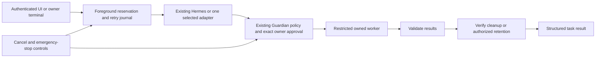

# Single-task architecture

Default: one foreground task per IGRIS checkout/runtime namespace, across chat, registered Guardian profiles, terminal specialists and Mission Control. This is a lightweight standard-library coordinator around existing components, not another reasoning or authorization framework.

The reservation is held through preparation, inference, approval waiting, execution and cleanup. A private SQLite journal stores IDs, hashes and bounded outcome metadata, never raw prompts, credentials, model outputs or approval authority. An OS file lock enforces exclusion across processes. The same request ID and body fingerprint cannot execute again; changing its body is rejected. Dashboard queues are bounded and volatile: restart never automatically drains old work. Clients must reuse the same request ID for a transport retry; identical text with a new ID is a new intentional request. The UI retains IDs across transport errors, without storing prompts in browser persistent storage.

Foreground states are idle, starting, running, waiting_for_approval, stopping, completed, failed and cancelled. Idle describes availability; completed/failed/cancelled remain in the last result and journal. Results carry task ID/type, start/completion times, actions attempted, verified outcomes, errors/limitations, cleanup status and an outcome classification. Outcomes distinguish successfully_completed, partially_completed, failed, cancelled and not_verified. Explicitly failed/unverified executor contracts cannot become successful results.

Cancellation sets a cooperative per-task signal and keeps the slot until cleanup completes. It does not permanently stop ordinary chat; emergency stop does, until explicit process restart. Completed side effects are not rolled back by a late cancellation. Approval decisions and stop requests use independent authenticated HTTP control paths; no second foreground worker is started to process them. The existing execution thread sleeps on a wakeup event rather than polling while idle. Frontend status refresh slows when idle and pauses network refresh while hidden.

The existing model/worker file lock remains a second resource safeguard. Specialists use the same Hermes adapter, GGUF and restricted no-native-tools configuration. One-shot mode stays default so model RSS can be released after a task; bounded warm mode remains explicit and does not create a second model. Only the selected specialist reasons. Definitions/hashes are metadata, not fifteen active model instances. Model workers receive no approval databases, parent credentials or raw Docker socket.

## Integrations

`integrations/catalog.py` supplies a small trusted static catalog, `IntegrationSpec` and lifecycle contract. Metadata describes name, finite capabilities, required permissions, resource estimates/ceilings and availability. Constructors/factories must be cheap; optional heavy code belongs in a restricted worker started after authorization. Only the requested factory resolves. Implementations expose start/shutdown, health, typed execution and cancellation/deadline handling; shutdown must release owned resources. Estimates are not measurements and ceilings are not RSS promises.

The real zero-process clock adapter demonstrates the contract through Guardian. Naukri, LinkedIn, GitHub, Gmail and browser catalog entries are disabled placeholders, not connected services. No account credentials, login/CAPTCHA/MFA automation, submissions, messaging or profile management are implemented. The existing owned-site browser remains a separate approved finite adapter; it is not silently activated by the placeholder.

To add an integration: implement a reviewed adapter/worker; declare its metadata and static factory; register finite operations/permissions/risk with existing Guardian; add exact target/scope validation and real acceptance tests. Metadata never grants permissions. Do not load arbitrary plugin modules or factories named by model/user JSON. Same-user trusted Python can modify objects; this is not isolation from a hostile host administrator.

n8n is not imported, installed or run by the new architecture. Its previous quarantined files remain preserved. The dashboard removes its workflow controls and rejects the old enable flag; a future optional adapter would require separate dependency remediation and review.

## Ops Pilot lifecycle

The existing unmodified pinned Ops Pilot and Triage sources, exact-target read-only Docker proxy, worker limits and export validator are reused. The worker is factored into a reusable session; the old explicitly requested one-shot CLI remains intact. Only the connector container, proxy and temporary files are stopped; the monitored disposable application is not stopped by connector cleanup.

| Mode | Startup | Execution and resource policy |
| --- | --- | --- |
| Manual, default | Explicit exact owner-approved start | Probes require separate task approvals; safely reuse the same component; explicit stop or console/server shutdown releases it. No silent start. |
| On-demand | Inside one approved probe task | Start, probe, validate and stop in finally, including error/timeout/cancellation. |
| Monitoring | Explicit owner-approved start in configured monitoring mode | Retain the component for authorized foreground probes until stopped or bounded session limits. No automatic production repair or periodic background poller. |

Resident sessions are limited to sixteen probes or one hour; expired/dead sessions require explicit stop/start, never automatic restart. They are not a 24/7 monitoring service. They use a private authenticated sequenced pipe and a separate session ownership lock; idle resident Ops does not reserve the model slot. The exact read proxy keeps Docker mutations and unrelated targets denied. Runtime, mode, timeout, target, daemon and current component ID are scope-bound. Manual/Monitoring retained workers are reported as `retained_authorized`, not stopped or fully cleaned. On-demand and stop operations verify removal.

Read-only disposable-target restrictions remain. No production targets, raw daemon access for models, privileged containers, automatic remediation, shell/code, paid services or client communication were enabled.

## Crash/recovery limits

A crash or uncertain cleanup leaves durable metadata and blocks new foreground work. Old IDs cannot rerun and old approvals are not automatically resumed. Owned launch acknowledgements and existing launch ledgers remain authoritative for process cleanup. Resolve uncertain ownership with owner inspection; never delete a ledger or kill a matching name blindly. `Foreground.recover` is a trusted maintenance API requiring an independently verified cleanup callback, not a model tool or an automatic reset switch. Pending conversation reservations may also need explicit owner recovery after a hard crash. Unknown cleanup, audit or database errors fail closed.

Normal completion, cancellation, injected worker failure and actual timeout were tested against real disposable resources. Kernel failures, abrupt-host-loss cleanup, hostile same-user modifications, database rollback and distributed/network-filesystem locks are not certified. Mac M1/ARM64 execution and resource use remain blocked pending authorized hardware testing.
