# Guardian-controlled tools — Phase 1 Milestone 3

The pre-implementation [audit](guardian-tools-audit.md) records the baseline.
This extends the existing Guardian policy, executor, broker and ApprovalStore;
there is no second policy engine or alternate privileged execution service.

```mermaid
flowchart LR
    U[Explicit local user request] --> C[Existing mission controller]
    C --> H[Offline Hermes: proposal only]
    H --> J[Untrusted JSON proposal]
    J --> G[Existing Guardian broker]
    G --> P[Policy + exact scope + approval]
    P --> X[One registered read-only tool]
    X --> A[Protected minimal audit]
    A --> R[Verified IGRIS result and chat memory]
```



Before, Hermes only produced text and native dispatch always denied. Now a separate
explicit tool mode asks real AIAgent.run_conversation for one JSON proposal.
It still exposes **zero native Hermes tools**. The host never interprets prose as
a command or substitutes a deterministic request for model output. The exact
bounded proposal string goes to the existing Guardian broker, which strictly
parses, validates and decides. Only then does a fixed handler execute. No recursive
tool loop or automatic retries are present. The final response renders the actual
broker result directly, avoiding a second model call that could invent success.
The planner receives bounded non-secret relative filename hints from the trusted
scope to reduce path hallucination. Hints are data, not authorization: the broker
reloads and validates the actual scope independently at execution.

## Registry and explicit policy

| Tool | Exact arguments | Permission and additional restriction |
| --- | --- | --- |
| get_current_time | `{}` | READ plus explicit operation allowlist; UTC, no network |
| list_workspace_files | `{"path":"."}` or an approved relative directory | READ; explicit directory and file allowlists; safe direct entries only |
| read_workspace_file | `{"path":"note.txt"}` | READ; explicitly allowed relative file, regular single-link UTF-8, at most 2048 bytes |

The names are registered in existing Policy. A READ grant alone does not activate
these tools: the broker also requires a trusted tools-only startup profile.
Default chat remains unchanged and does not execute tools. A profile may allow
an empty operation list, resulting in DENY for every proposal. Only these three
operations can be allowlisted. Tools-only mode rejects legacy file.create,
file.read, python.version, specialist fixtures, recovery, Git, production and
financial/communication operations even if the caller's Policy grants more.

Directory listing is nonrecursive and includes only configured safe files whose
immediate parent matches the requested approved directory. It excludes unknown,
symlink, hardlinked, oversized and nonregular entries. It does not enumerate
other names. Missing approved entries are omitted. Directory failure is an error.
Read requires the exact configured path and rejects absolute paths, traversal,
empty/dot/hidden components, shell metacharacters, sensitive names, symlinks,
hardlinks, FIFOs/devices, binary and oversized files. The broker holds no-follow
directory descriptors through traversal and validates the final open file.
Known sensitive output patterns and terminal controls are filtered. Regex filters
cannot recognize all secrets; use only synthetic, non-sensitive test documents.

## Explicit cloud setup and use

Use the already documented [verified cloud runtime](../../integrations/hermes-inference/README.md).
The following helper creates a new private demonstration directory and refuses
to overwrite an existing one. It starts no service and installs nothing:

```sh
$ python3 scripts/create_guardian_test_workspace.py
$ PYTHONPATH=src python3 -m igris.chat --remember --tools-config runtime/guardian-demo/tools.json
```

Ask for current time, listing `.` or reading `note.txt`. Tool mode accepts one tool
intent per turn. Use the normal chat invocation without `--tools-config` for
ordinary conversation. Both modes use the existing owner-controlled conversation
storage. Prompts still travel through stdin, never process arguments:

```sh
$ PYTHONPATH=src python3 -m igris.chat --remember --tools-config runtime/guardian-demo/tools.json --once --json
$ PYTHONPATH=src python3 -m igris.chat --remember --resume
```

Configuration is a 0600 ordinary single-link JSON file under a 0700 trusted
parent, outside the approved workspace. Exact keys: version=1, absolute workspace,
allowed_operations, directories, files and approval_required. All lists are
bounded, duplicate-free and validated. Workspace must be an owned private 0700
directory with no symlink components and cannot be filesystem root or a repository
root. File parents must be explicitly approved directories. The model cannot
choose this file, root, actor, permission set, store or correlation IDs.

The existing ApprovalStore and its new tool_audit table live in private ignored
chat state outside the approved workspace, never mounted in the model container.
This is development-only local storage; no production permission store is created.
No database/model/cache is added to Git. `--list` does not start inference/tools.

## Approval handling

Safe read-only operations run only under the explicit policy/profile. Setting a
tool in approval_required adds existing ApprovalStore consumption at the execution
boundary. Both permission and approval must hold. New approval binding covers
operation, exact arguments, actor, workspace, environment, policy version,
canonical scope digest and the intended controller mission/request IDs. Existing
expiry, denied/pending rejection and atomic single-use semantics remain. An old
unbound approval or changed intent/scope cannot authorize a new tool request.
Unexpected approvals are denied on tools that do not require one.

There is **no interactive approval issuer in chat**. Approval-required requests
remain blocked. The model has no reference field that can approve a request;
extra JSON fields such as actor, approval_id and policy are rejected. Trusted test
code exercises the existing issuance/decision API with clearly synthetic owner
approvals. This is proof of enforcement, not an authenticated real-user approval
UI. The trusted wiring never forwards a model-generated approval reference.
History, database restoration and old conversations do not mint permissions.
No mutating operations are enabled even after an approval.

## Isolation and audit boundaries

The model retains the existing no-network, non-root, read-only, no-capabilities,
no-new-privileges container, fixed image/artifact hashes, CPU/memory/PID/tmpfs
limits and timeout/cleanup. It never receives the approved workspace, chat,
audit/approval databases or Docker socket. Safe-worker mode and native tool denial
remain active. No browser, arbitrary Python or shell API is provided.

The existing broker remains a separate isolated/no-site Python process with a
scrubbed environment, fixed trusted source, 3-second wall timeout, 2-second CPU,
256-MiB address space, 64 descriptors, bounded file/output sizes and no core dump.
Tools-only mode additionally applies Linux x86_64 no-new-privileges/seccomp:
network and new executable/child-process syscalls are denied. Installation failure
fails closed; there is no unrestricted fallback. The legacy broker modes retain
their existing behavior and are not exposed through chat. The new mode's kernel
restrictions are tested with real socket and process-creation attempts.

ApprovalStore records minimal tool events: trusted actor, request/mission IDs,
registered operation or `unregistered`, raw-proposal SHA-256, timestamp,
authorized/completed/denied/execution_failed/timeout/interrupted/broker_failed and
measured timings. Raw arguments, file contents, prompts, arbitrary operation
strings and exception text are not logged. Authorization is audited before the
handler runs. Required audit failure blocks execution; audit acknowledgement
failure never reports success. A separate timeout event is recorded after a real
worker is killed. The table caps at 10,000 rows and then fails closed; trusted
retention/export tooling is not yet implemented.

Same-user processes, the host Docker operator/kernel and trusted source/config
remain outside the threat boundary. A compromised host can edit the local SQLite
store, forge decisions or roll back clocks/data. Audit is neither encrypted nor
immutable. Seccomp is defense in depth, not complete filesystem/MAC isolation;
Guardian still relies on its reviewed handlers for scoped filesystem access.
No independent claim of a fully sandboxed or prompt-injection-proof system is
made. Injection can affect proposed actions/answer quality; it cannot enlarge the
three-tool registry or the broker's allowed scope. SIGKILL/host failure can leave
an unfinished chat lease/model container requiring operator review. Normal
exceptions, timeout and interruption clean up the specific child/container.

Specialists and n8n have no new execution channel: live modes remain unavailable,
and existing specialist fixtures require their original exact Guardian approvals.
Untrusted workflow/model/role text cannot select a handler, policy or startup mode.
Trusted developer Git/project utilities remain outside the model tool registry.

## Verification and performance scope

```sh
$ python3 -m unittest discover -s tests -p test_guardian_tools.py -v
$ python3 scripts/test_guardian_tools_live.py
$ python3 scripts/test_chat_live.py
$ python3 -m unittest discover -s tests -q
$ PYTHONPATH=src python3 -m igris.guardian.scan
```

The new live harness instruments and forwards actual Hermes outputs unchanged;
it does not replace inference or broker results. It uses disposable synthetic
files and real process/SQLite boundaries. It checks time, listing, outside reads,
shell attempts, malicious document instructions, synthetic approval binding,
failure/timeout and actual CLI restarts with persisted context but no revived
approval. Only the timeout deadline is shortened in test code; no process is
mocked. The unit suite's original timeout mock and legacy simulated adapters
remain explicitly labeled. See the milestone report and source-bound live JSON
for actual outcomes, failed attempts, timings and remaining blockers.

Generation time measures the real Hermes run_conversation call; proposal wall
time includes artifact checks/container/model startup. Guardian authorization
and handler latency are measured separately; broker wall time includes startup,
profile validation, kernel setup, audit and communication. Process peak RSS is
reported in Linux KiB for Hermes, its exited model child and the broker. These are
per-process high-water marks, not summed physical usage, cgroup peak or Mac M1
measurements. No Mac software is installed or hardware certification implied.
